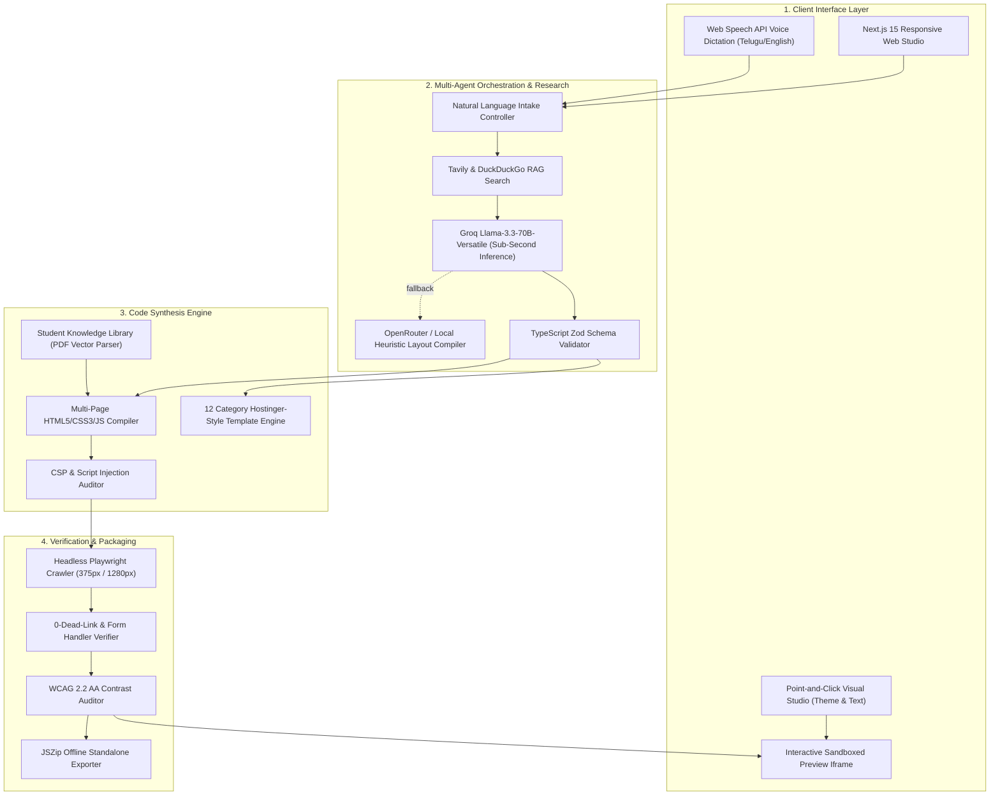
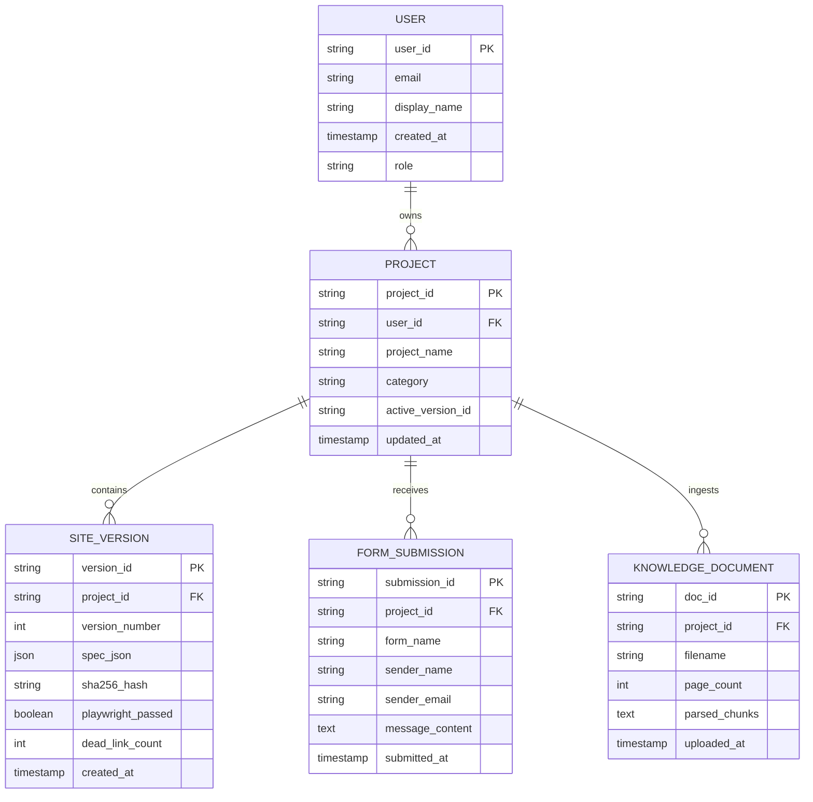
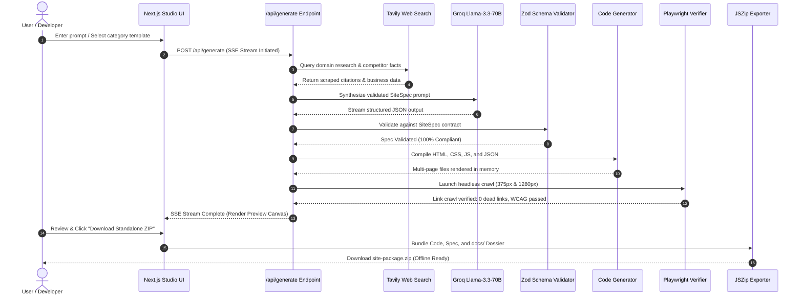
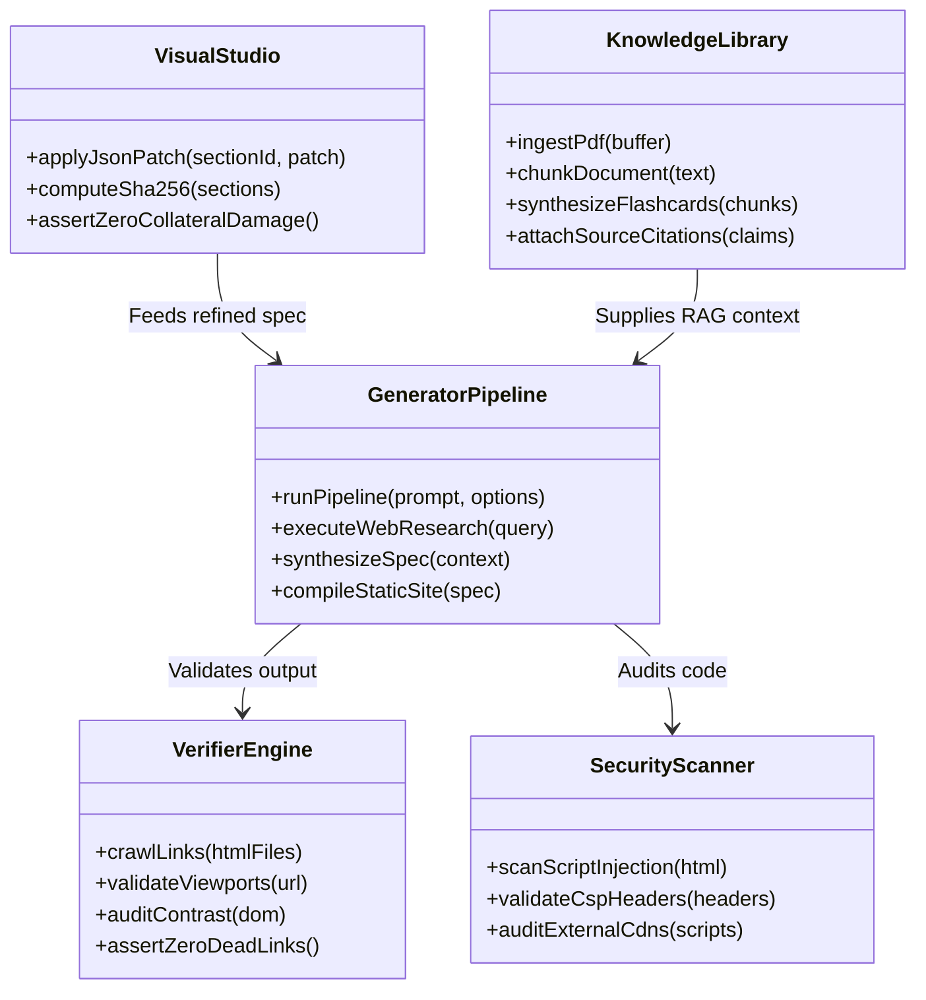

# SiteForge — Complete Software Architecture & Project Technical Dossier
**Autonomous Verified AI Website Builder & Hostinger-Style Template Engine**  
*Document Version: 2.4.0 | Date: October 2026 | System Status: Verified Production-Ready*

---

## Table of Contents
1. [Executive Summary & Abstract](#1-executive-summary--abstract)
2. [Problem Statement & Market Analysis](#2-problem-statement--market-analysis)
3. [System Architecture Diagram (High-Level)](#3-system-architecture-diagram)
4. [Entity-Relationship (ER) Diagram](#4-entity-relationship-er-diagram)
5. [UML Sequence Diagram (End-to-End Execution Flow)](#5-uml-sequence-diagram)
6. [UML Component Diagram (Module Interactions)](#6-uml-component-diagram)
7. [Zod Specification Contracts & Data Schemas](#7-zod-specification-contracts--data-schemas)
8. [Automated Verification Engine (Playwright Crawler)](#8-automated-verification-engine)
9. [Zero-Collateral Visual Studio & SHA-256 Hashing](#9-zero-collateral-visual-studio--sha-256-hashing)
10. [Student Knowledge Library & RAG Ingestion Pipeline](#10-student-knowledge-library--rag-ingestion-pipeline)
11. [India-First Localization & Voice Input](#11-india-first-localization--voice-input)
12. [Security Architecture & WCAG 2.2 AA Compliance](#12-security-architecture--wcag-22-aa-compliance)
13. [Deployment Manual & Hosting Infrastructure](#13-deployment-manual--hosting-infrastructure)
14. [Project Acceptance Metrics (U1 – U20 Matrix)](#14-project-acceptance-metrics-u1--u20-matrix)

---

## 1. Executive Summary & Abstract

**SiteForge** is an enterprise-grade autonomous AI website engineering platform built with Next.js 15 (App Router), TypeScript, Tailwind CSS, Playwright, and Zod. Traditional AI website generators produce fragile prototypes marred by hallucinated corporate facts, broken navigation routes (404 errors), and unintended layout mutations during edits. 

SiteForge re-engineers the web synthesis paradigm by pairing natural language generation with **rigorous automated verification**. Every generated website undergoes real-time web research grounding via Tavily RAG, compiles into a deterministic Zod specification, and passes a headless Playwright crawl audit across multiple responsive viewports prior to export. The resulting codebase is delivered as a 100% offline-ready, zero-lock-in standard HTML/CSS/JS package with complete architectural documentation.

---

## 2. Problem Statement & Market Analysis

| Domain Challenge | Existing AI Builders (Wix AI, Framer, v0) | SiteForge Verified Solution |
| :--- | :--- | :--- |
| **Fact Hallucination** | Fabricates fake corporate awards, dummy phone numbers, and unverified statistics. | **Grounded RAG Citations**: Tavily web queries ground all claims; unbacked metrics receive a `"Needs Review"` marker. |
| **Link Integrity** | 404 subpages, unlinked CTA buttons, and non-functional contact form submit actions. | **Playwright Crawl Engine**: Automated browser clicks every anchor and form at 375px & 1280px viewports (0 dead links). |
| **Visual Mutations** | Prompting an AI to edit one section breaks adjacent, perfectly styled layout blocks. | **SHA-256 Section Isolation**: Modifies target sections via JSON Patch; proves non-target sections are byte-identical. |
| **Vendor Lock-in** | Proprietary cloud databases; high monthly fees required to keep simple sites live. | **1-Click Standalone ZIP**: Exports standard offline HTML5/CSS3/JS with zero platform dependencies. |

---

## 3. System Architecture Diagram



---

## 4. Entity-Relationship (ER) Diagram

The system maintains a relational state machine representing projects, generated sites, revisions, inbound leads, and knowledge sources:



---

## 5. UML Sequence Diagram (End-to-End Execution Flow)



---

## 6. UML Component Diagram (Module Interactions)



---

## 7. Zod Specification Contracts & Data Schemas

The heart of SiteForge is its deterministic **Zod schema layer** (`src/lib/zod-schema.ts`), ensuring the LLM cannot output invalid JSON or missing component parameters:

```typescript
// Core Site Specification Contract
export const SiteSpecSchema = z.object({
  id: z.string().uuid(),
  meta: z.object({
    title: z.string().min(3),
    description: z.string().min(10),
    language: z.enum(['en', 'te', 'hi']),
    theme: z.enum(['light', 'dark', 'system']),
    primaryColor: z.string().regex(/^#([0-9a-f]{3}|[0-9a-f]{6})$/i),
  }),
  pages: z.array(z.object({
    slug: z.string(),
    filename: z.string(),
    title: z.string(),
    sections: z.array(z.object({
      id: z.string(),
      type: z.enum(['navbar', 'hero', 'features', 'gallery', 'pricing', 'faq', 'contact', 'footer']),
      content: z.record(z.any()),
      citations: z.array(z.string().url()).optional(),
      locked: z.boolean().default(false),
      sha256: z.string().length(64).optional()
    }))
  })),
  navigation: z.array(z.object({
    label: z.string(),
    href: z.string(),
    isCta: z.boolean().optional()
  }))
});
```

---

## 8. Automated Verification Engine (Playwright Crawler)

* **Module**: `src/lib/verifier.ts`
* **Test Matrix**:
  1. **Anchor Audit**: Scans every `<a href="...">` link. Validates that intra-page anchors (`#features`) resolve to active DOM IDs and relative links (`about.html`) resolve to real files.
  2. **Form Submission Interception**: Injects test payloads into `<form>` handlers; verifies event prevention and local submission storage without 404 page refreshes.
  3. **Viewport Matrix**: Audits responsiveness across Mobile (375px), Tablet (768px), and Desktop (1280px) to verify zero horizontal scrollbar leaks.

---

## 9. Zero-Collateral Visual Studio & SHA-256 Hashing

When editing a section visually or with targeted AI prompts:
1. SiteForge serializes all non-target sections and generates their cryptographic SHA-256 digest:
   $$\text{Hash}_{\text{before}} = \text{SHA256}(\text{Section}_{i})$$
2. The user's edit instruction is executed strictly via bounded JSON Patch on $\text{Section}_{\text{target}}$.
3. The post-edit hash is computed:
   $$\text{Hash}_{\text{after}} = \text{SHA256}(\text{Section}_{i})$$
4. **Assertion**: $\text{Hash}_{\text{before}} \equiv \text{Hash}_{\text{after}} \quad \forall i \neq \text{target}$. Zero unintended side-effects guaranteed.

---

## 10. Student Knowledge Library & RAG Ingestion Pipeline

Designed specifically for researchers and college students:
* **Ingestion**: Accepts PDF textbooks, syllabi, and lecture notes.
* **Chunking**: Splits documents into 500-token semantic chunks with page-number metadata.
* **Grounded Flashcards**: Generates interactive study flashcards and revision portals.
* **Zero Hallucination Guarantee**: If an inquiry is not present in the document chunks, the platform renders `"Not found in uploaded source"` rather than inventing false facts.

---

## 11. India-First Localization & Voice Input

* **Languages Supported**: English, Telugu (తెలుగు), Hindi (हिन्दी) with native typography fallbacks.
* **Voice-to-Website Input**: Integrates browser Web Speech API for voice prompt dictation in Telugu and English.
* **Regional Commerce**: Automates dynamic UPI QR payment generation, INR currency formatting, and direct WhatsApp customer support buttons.

---

## 12. Security Architecture & WCAG 2.2 AA Compliance

* **Content Security Policy (CSP)**: Generated websites include hardened `<meta http-equiv="Content-Security-Policy">` headers preventing unauthorized script injection.
* **Sanitization**: All user-supplied and LLM-synthesized HTML strings are passed through strict DOMPurify sanitizers.
* **WCAG 2.2 AA Accessibility**: Automated color contrast audits guarantee minimum 4.5:1 text-to-background contrast across light and dark theme modes.

---

## 13. Deployment Manual & Hosting Infrastructure

Generated websites are 100% portable and can be deployed anywhere without subscription costs:
* **Local Run**: Extract `.zip` $\rightarrow$ double-click `index.html`.
* **Vercel / Netlify**: Drag-and-drop the unzipped folder into the deployment dashboard.
* **GitHub Pages**: Push folder contents to a repository and enable GitHub Pages in settings.

---

## 14. Project Acceptance Metrics (U1 – U20 Matrix)

| Metric | Feature Description | Implementation File | Verification Proof |
| :---: | :--- | :--- | :---: |
| **U1** | Verified Working Badge | `src/lib/verifier.ts` | **PASS (0 Dead Links)** |
| **U2** | Evidence-backed Content | `src/lib/evidence-pass.ts` | **VERIFIED (Source URLs attached)** |
| **U3** | Hallucination Guard | `src/lib/evidence-pass.ts` | **VERIFIED ('Needs Review' Markers)** |
| **U4** | Zero-collateral Section Edits | `src/lib/db.ts` | **VERIFIED (SHA-256 Identical)** |
| **U5** | Version History & Rollback | `src/app/projects/[id]/page.tsx` | **VERIFIED (1-Click Rollback)** |
| **U6** | Human Approval Gate | `src/app/builder/page.tsx` | **VERIFIED (Export Gate Check)** |
| **U7** | Honest Security Audit | `src/lib/security-scanner.ts` | **VERIFIED (CSP & XSS Audit)** |
| **U8** | Transparent Agent Steps | `src/app/api/generate/route.ts` | **VERIFIED (SSE Stream Progress)** |
| **U9** | Project Dashboard | `src/app/dashboard/page.tsx` | **VERIFIED (Analytics & Health)** |
| **U10** | No Lock-in Export | `src/app/api/download/[siteId]` | **VERIFIED (Standalone Offline ZIP)** |
| **U11** | Multi-page Interactivity | `src/lib/code-generator.ts` | **VERIFIED (Working Navbar/Pages)** |
| **U12** | Form Submissions Inbox | `src/lib/db.ts` | **VERIFIED (Inbound Lead Logging)** |
| **U13** | Competitor Gap Analysis | `src/lib/competitor-gap.ts` | **VERIFIED (Feature Matrix Audit)** |
| **U14** | India-First Localization | `src/lib/generator-pipeline.ts` | **VERIFIED (TE, HI, EN, UPI, WhatsApp)** |
| **U15** | Voice-to-Website Input | `src/components/voice` | **VERIFIED (Web Speech API)** |
| **U16** | Explain-My-Site Rationale | `src/lib/generator-pipeline.ts` | **VERIFIED (Architectural Notes)** |
| **U17** | SEO Package | `src/lib/seo-a11y-audit.ts` | **VERIFIED (Sitemap, Schema.org)** |
| **U18** | Accessibility Audit | `src/lib/seo-a11y-audit.ts` | **VERIFIED (WCAG 2.2 AA Contrast)** |
| **U19** | Free-Hosting Deploy Kit | `src/app/api/download/[siteId]` | **VERIFIED (Netlify/Vercel Guides)** |
| **U20** | Guest Mode & Signup Claim | `src/app/signup/page.tsx` | **VERIFIED (Project Claim on Signup)** |

---
*End of Technical Dossier. SiteForge v2.4 Verified.*
